# SMK_v2 — Kịch bản và lưu đồ thuật toán toàn dự án

Viết theo **code hiện tại** (2026-10-02) của chìa (`key/`), ECU (`ecu/`) và lõi bảo mật (`vkey_core/`). Phần nào mới là thiết kế, chưa code, gom ở **Phần E**.

Thay cho `so-do-mermaid.md` và `so-do-de-hieu.md`, hai file đó vẽ theo kiến trúc cũ.

**Ký hiệu lưu đồ:**

| Ký hiệu | Cú pháp Mermaid | Ý nghĩa |
|---|---|---|
| Elip | `id(["..."])` | Bắt đầu / Kết thúc |
| Hình bình hành phải | `id[/"..."/]` | Nhập, chờ dữ liệu |
| Hình bình hành trái | `id[\"..."\]` | Xuất: LED, còi, gửi khung |
| Chữ nhật | `id["..."]` | Bước xử lý |
| Thoi | `id{"..."}` | Rẽ nhánh |
| Chữ nhật viền kép | `id[["..."]]` | Gọi lưu đồ khác |

**Mục lục**

- [0. Toàn cảnh](#0-toàn-cảnh)
- Phần A — Chìa: [A1 Vòng lặp chính](#a1-vòng-lặp-chính-của-chìa) · [A2 Thao tác nút](#a2-nhận-diện-thao-tác-nút) · [A3 Nút → lệnh](#a3-quyết-định-hành-động-theo-nút) · [A4 Gửi lệnh](#a4-gửi-lệnh-tới-xe) · [A5 Ghép chìa](#a5-ghép-chìa-phía-chìa) · [A6 Hiện diện](#a6-hiện-diện-phía-chìa-nghe-xe--gọi-xe--trả-lời-đo) · [A7 LED](#a7-đèn-led-của-chìa)
- Phần B — ECU: [B1 Khởi động](#b1-khởi-động-ecu) · [B2 Khung VKEY](#b2-xử-lý-một-khung-vkey-từ-chìa--app) · [B3 Ghép thiết bị](#b3-ghép-thiết-bị-phía-ecu-và-chia-slot) · [B4 Phiên đo](#b4-phiên-đo-khoảng-cách-channel-sounding) · [B5 GẦN/XA](#b5-kết-luận-gần--xa--trong-xe) · [B6 Trạng thái xe](#b6-máy-trạng-thái-xe) · [B7 Lệnh](#b7-luật-cho-lệnh-từ-chìa--app) · [B8 Hiện diện & timer](#b8-luật-hiện-diện-và-timer-nền) · [B9 Phanh](#b9-phanh-nhấp-giữ-đề) · [B10 Nút cốp](#b10-nút-cốp-trên-xe) · [B11 Chấp hành](#b11-cơ-cấu-chấp-hành) · [B12 CAN](#b12-đọc-can-dòng-minio) · [B13 Chống trộm](#b13-chống-trộm)
- [Phần C — App SmartKey](#phần-c--app-smartkey)
- [Phần D — Kịch bản từ đầu tới cuối](#phần-d--kịch-bản-sử-dụng-từ-đầu-tới-cuối)
- [Phần E — Chưa code](#phần-e--thiết-kế-chưa-code)

---

## 0. Toàn cảnh

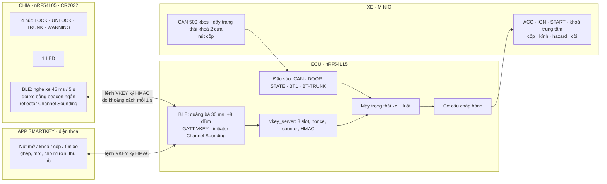

| Tính năng | Ở đâu | Lưu đồ |
|---|---|---|
| Nút chìa → lệnh | chìa | A2, A3, A4 |
| Ghép chìa / app | chìa + ECU | A5, B3, C |
| Tự mở / tự khoá theo khoảng cách | chìa + ECU | A6, B4, B5, B8 |
| Xác thực lệnh | ECU | B2 |
| Khoá, mở, cốp, tìm xe, đề từ xa | ECU | B7, B11 |
| Đề bằng phanh | ECU | B9 |
| Timer nền (hết giờ, tự khoá) | ECU | B8 |
| Chống trộm | ECU | B13 |

---

# PHẦN A — CHÌA

## A1. Vòng lặp chính của chìa

Một luồng duy nhất làm mọi việc dùng radio (lệnh nút, ghép, link đo), nên các việc này không bao giờ chồng nhau.

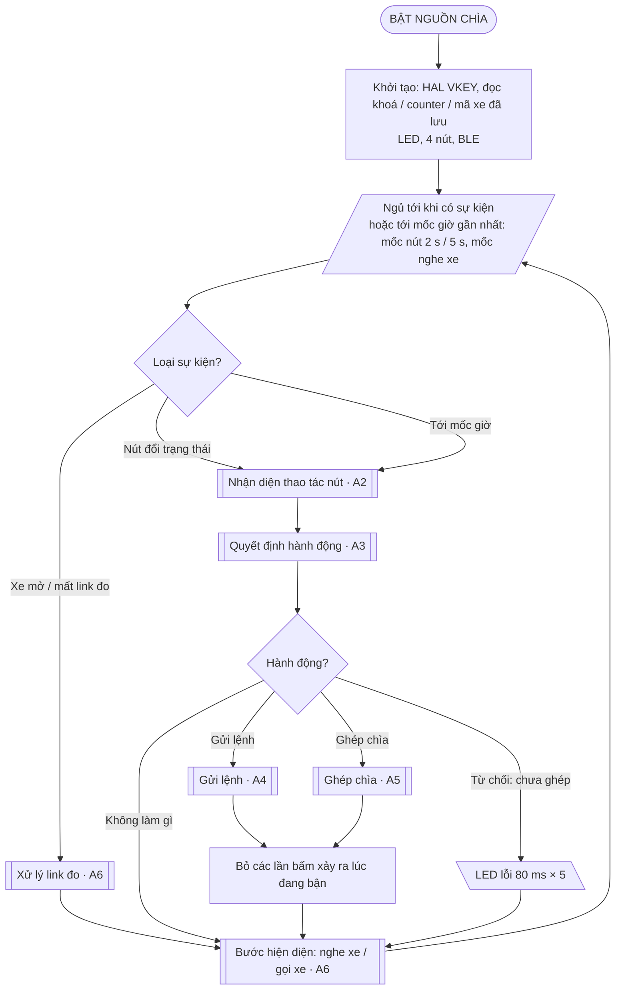

## A2. Nhận diện thao tác nút

Nút được chống dội 20 ms trong driver. Thao tác "giữ" phát **ngay lúc đủ thời gian**, không đợi nhả.

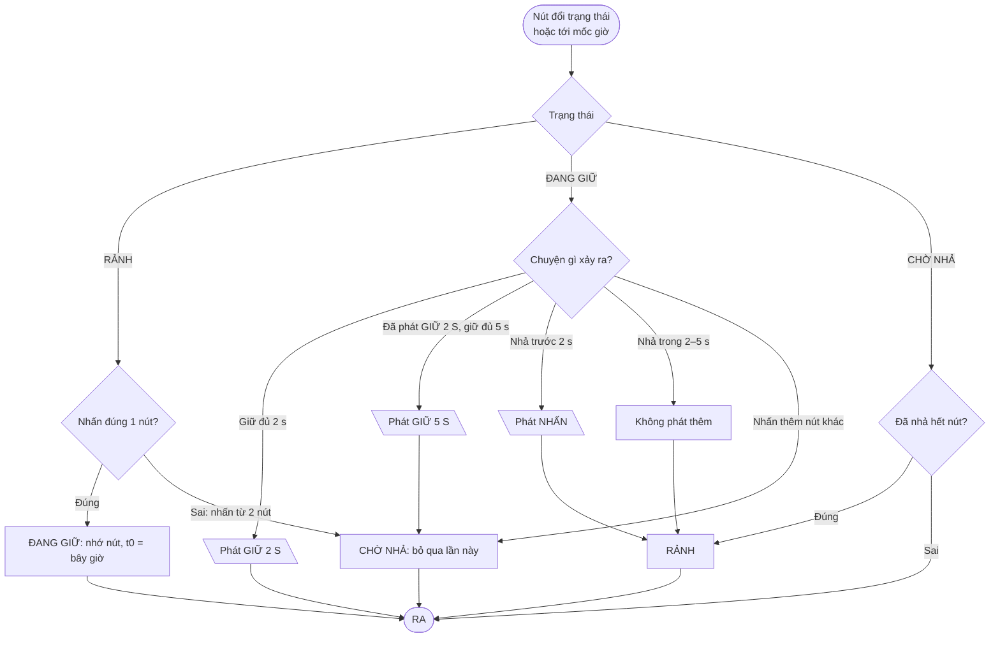

## A3. Quyết định hành động theo nút

| Nút | NHẤN (dưới 2 s) | GIỮ 2 S | GIỮ 5 S |
|---|---|---|---|
| LOCK | Khoá (`LOCK_ALL`) | Khoá | — |
| UNLOCK | Mở (`UNLOCK_ALL`) | **Đề từ xa** (`REMOTE_START`) | — |
| TRUNK | Mở cốp (`TRUNK_RELEASE`) | Mở cốp | — |
| WARNING | **Tìm xe** (`FIND_CAR`) | không làm gì (đang đếm tới 5 s) | **Ghép chìa** |

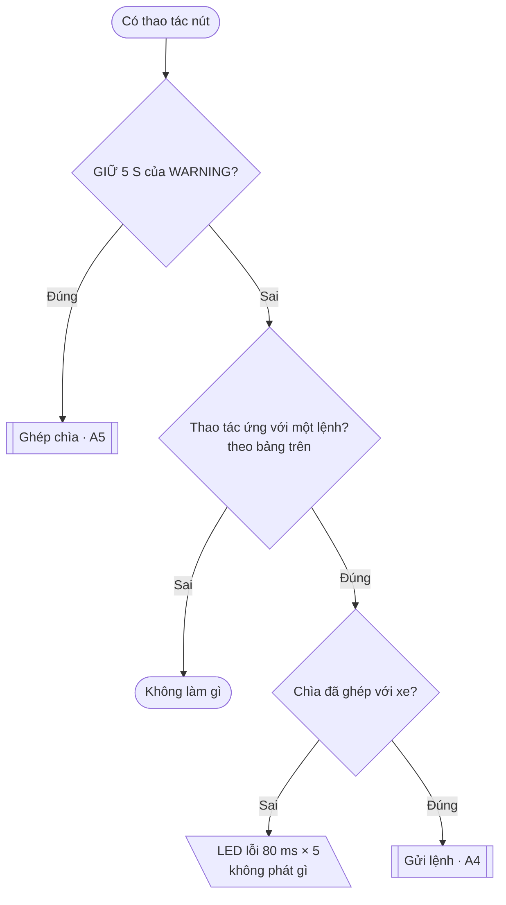

## A4. Gửi lệnh tới xe

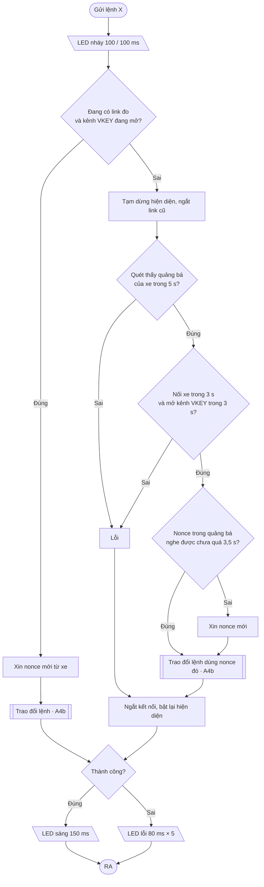

### A4b. Trao đổi một lệnh (chính sách trả lời, giống app)

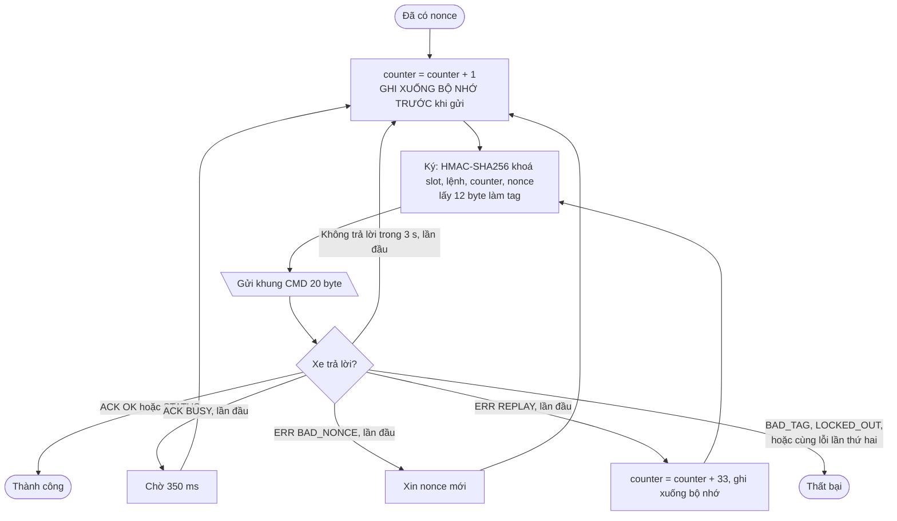

> ECU từ chối lệnh (ví dụ xe chưa đỗ) cũng trả **ACK BUSY**, vì `vkey_core` không có mã lỗi riêng. Chìa thử lại một lần sau 350 ms rồi báo lỗi.

## A5. Ghép chìa (phía chìa)

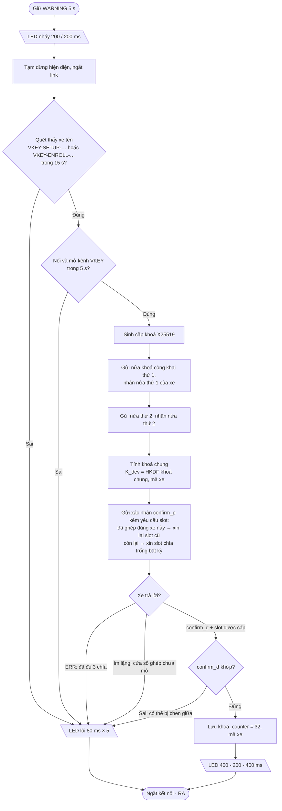

## A6. Hiện diện phía chìa: nghe xe – gọi xe – trả lời đo

Chìa là **bên thu**: không phát gì cho tới khi nghe thấy xe. Không dùng RSSI; khoảng cách chỉ do xe đo bằng Channel Sounding.

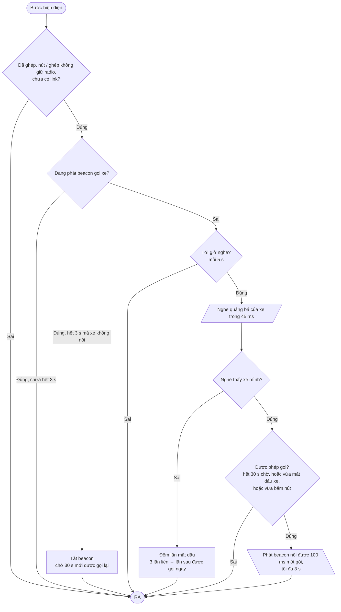

Khi xe nối vào (lưu đồ B4 ở phía xe):

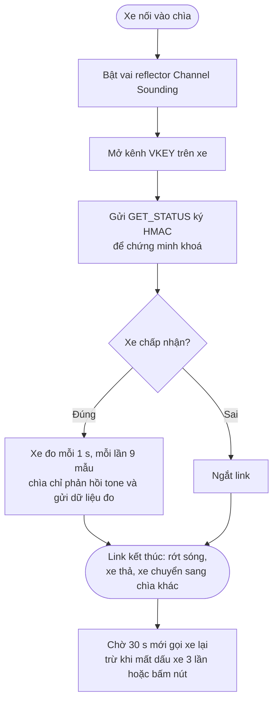

## A7. Đèn LED của chìa

| Khi nào | Mẫu nháy |
|---|---|
| Đang gửi lệnh | 100 ms sáng / 100 ms tắt, lặp |
| Lệnh thành công | sáng 150 ms |
| Lỗi (chưa ghép, không thấy xe, xe từ chối…) | 80 ms × 5 |
| Đang ghép | 200 ms / 200 ms, lặp |
| Ghép xong | 400 – 200 – 400 ms |

---

# PHẦN B — ECU

## B1. Khởi động ECU

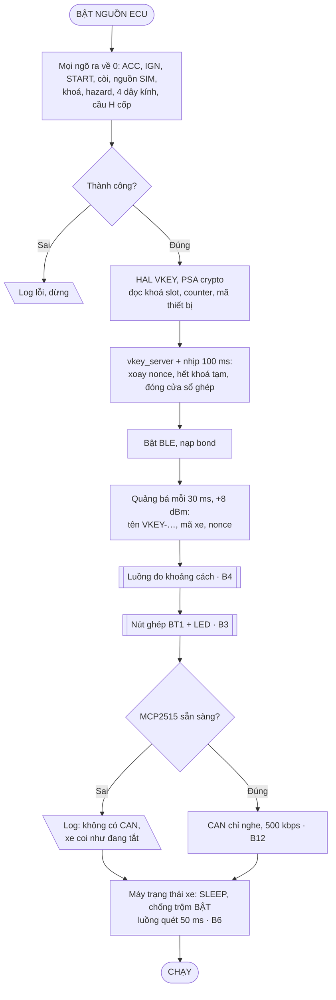

## B2. Xử lý một khung VKEY từ chìa / app

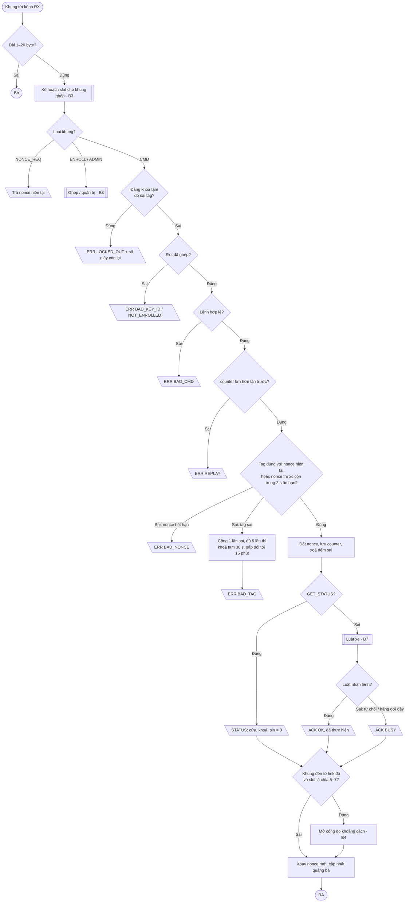

## B3. Ghép thiết bị (phía ECU) và chia slot

| Slot | Dành cho |
|---|---|
| 0 | App chủ xe (duy nhất ký được lệnh quản trị) |
| 1–4 | App máy phụ / người mượn |
| 5–7 | Chìa (tối đa 3) |

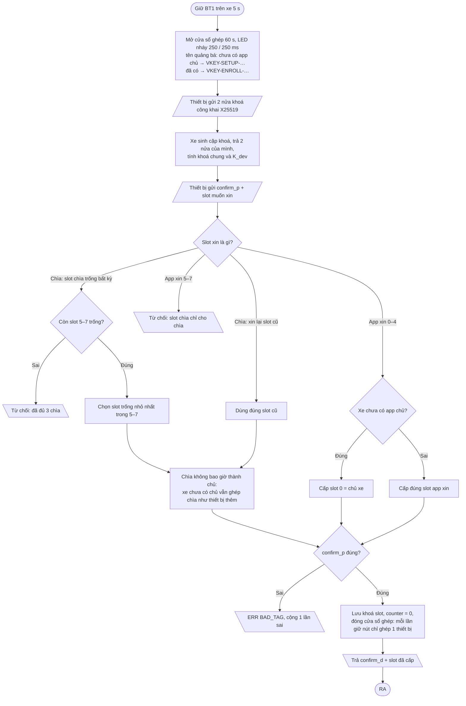

- Không giữ nút thì xe **im lặng** với mọi yêu cầu ghép, kể cả xe mới chưa có chủ.
- App chủ còn có thể **mời** máy khác bằng QR (không cần ra xe), cho **mượn có hạn**, và **thu hồi** một slot (lệnh ADMIN chỉ slot 0 ký được). Lời mời xin slot 5–7 bị từ chối.

## B4. Phiên đo khoảng cách (Channel Sounding)

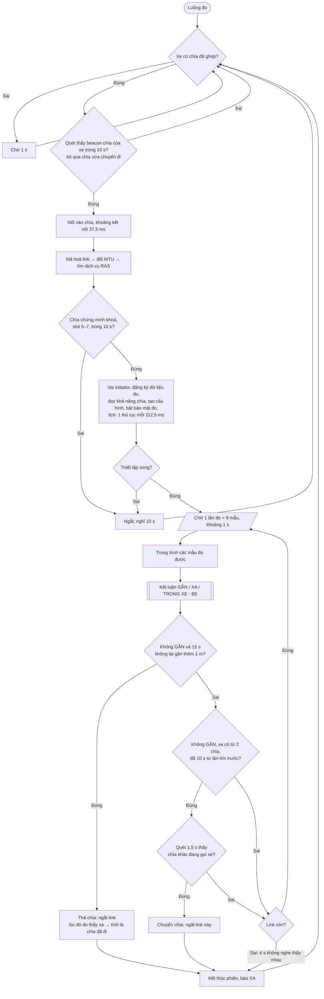

## B5. Kết luận GẦN / XA / TRONG XE

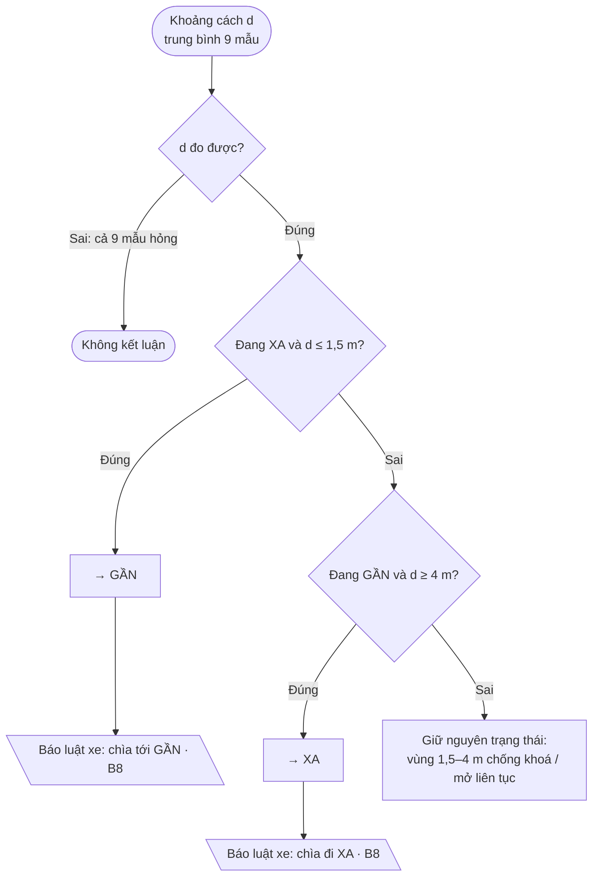

- **TRONG XE** (dùng khi giữ phanh để đề): lần đo gần nhất d < 0,5 m và không cũ quá 2 s.
- **Mất link** thì XA ngay.
- **Bằng chứng chìa ở xa** (cho luật tự khoá 17): đang đo thấy d ≥ 4 m, hoặc link rớt trong lúc xe đang mở khoá.

## B6. Máy trạng thái xe

| Trạng thái | ACC | IGN | Ý nghĩa |
|---|---|---|---|
| SLEEP | 0 | 0 | xe tắt, đã khoá |
| STANDBY | 0 | 0 | xe tắt, đã mở khoá |
| ON | 1 | 1 | bật điện, chưa sẵn sàng chạy |
| READY | 1 | 1 | đã đề, sẵn sàng chạy |
| REMOTE_ON | 1 | 1 | đề từ xa, cửa khoá, tối đa 10 phút |

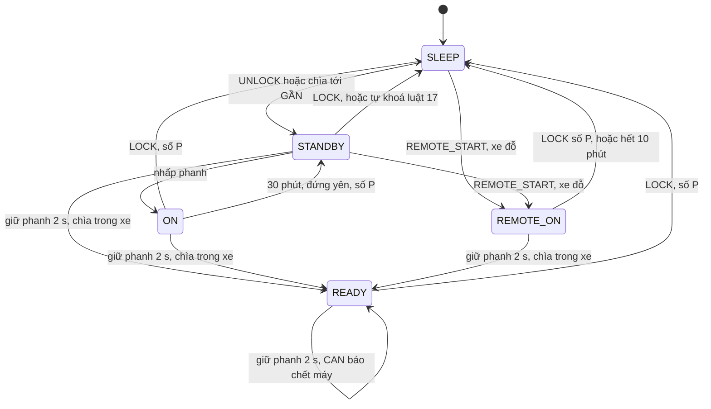

Hai điều kiện dùng chung:

- **Xe đỗ:** CAN còn tín hiệu thì số P hoặc phanh tay kéo; CAN im thì xe phải đang tắt (bus ngủ).
- **Được tắt xe:** CAN còn tín hiệu **và** số P. Riêng hết giờ đề từ xa mà mất CAN thì vẫn tắt.

## B7. Luật cho lệnh từ chìa / app

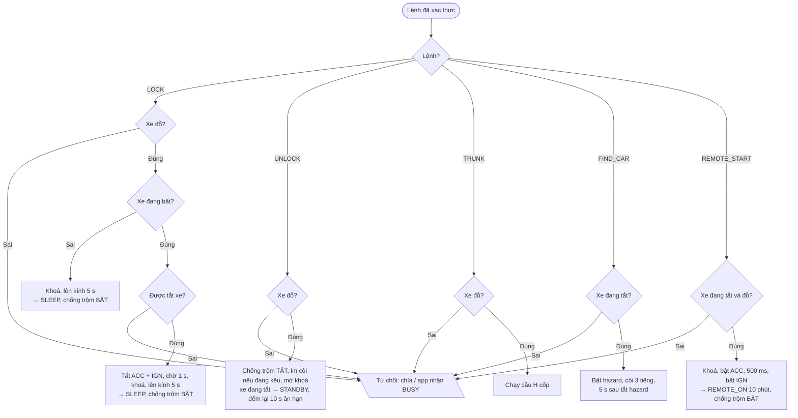

## B8. Luật hiện diện và timer nền

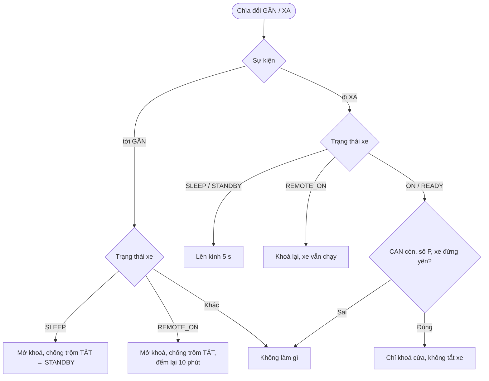

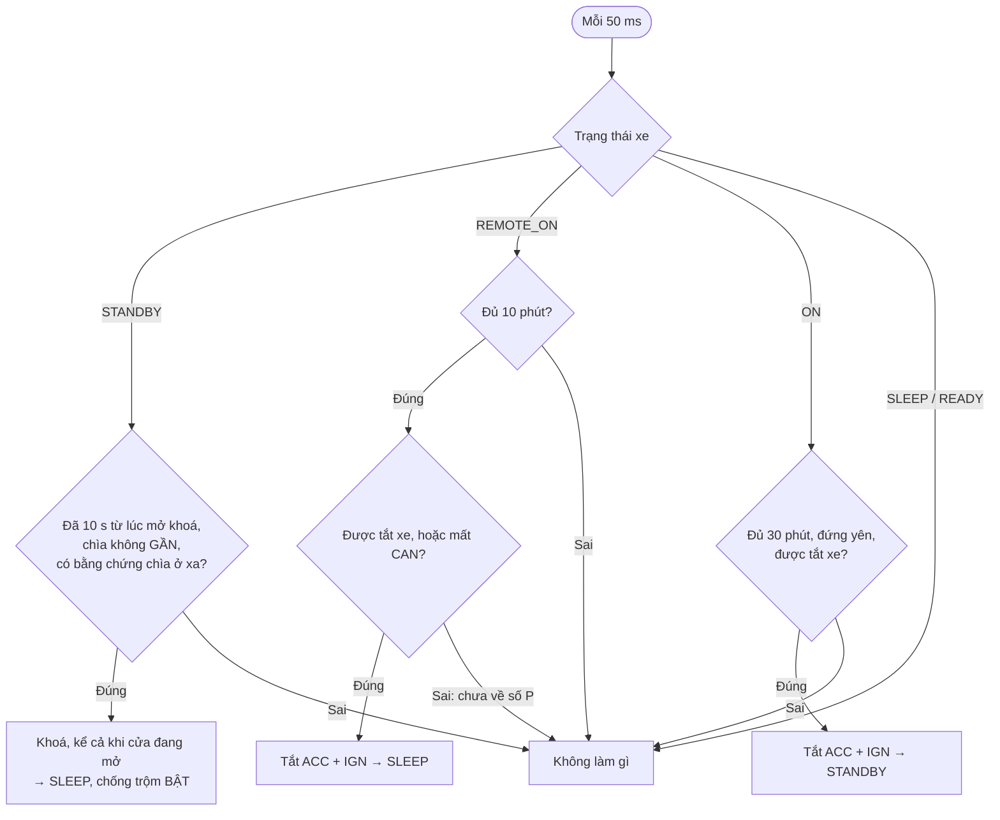

## B9. Phanh: nhấp, giữ, đề

Tín hiệu phanh lấy từ CAN, quét mỗi 50 ms.

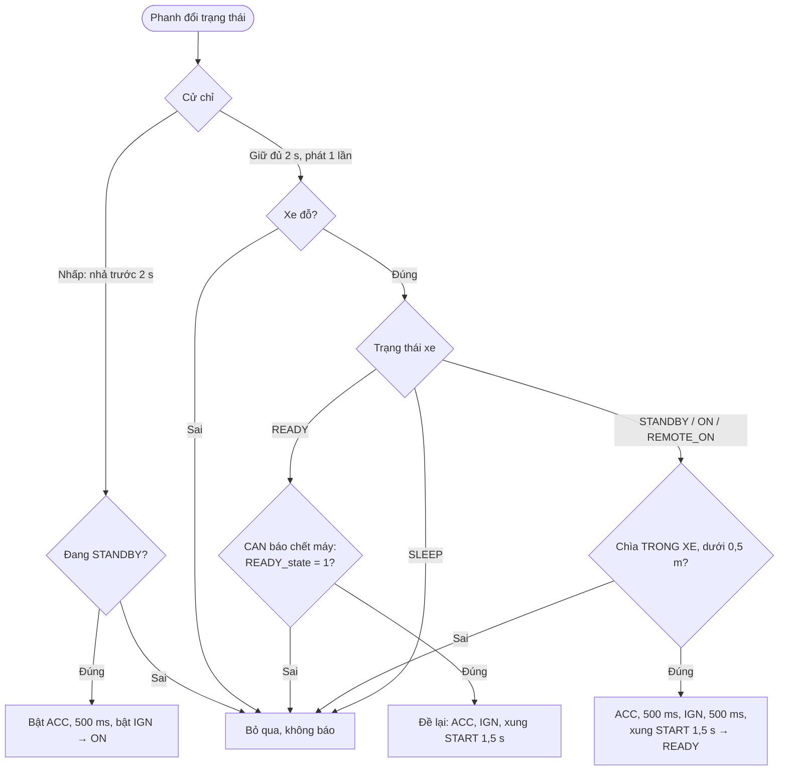

## B10. Nút cốp trên xe

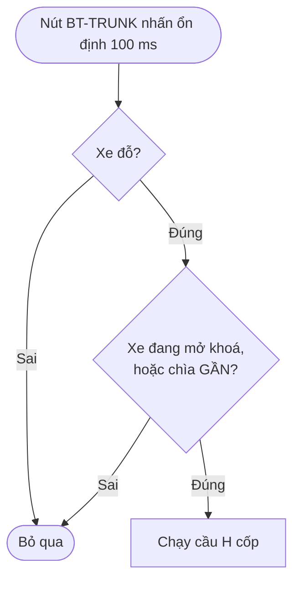

## B11. Cơ cấu chấp hành

Một luồng duy nhất lấy từng việc trong hàng đợi và chạy theo **thứ tự cố định**:

```mermaid
flowchart TD
    S(["Lấy 1 việc từ hàng đợi"]) --> AO{"Tắt báo động?"}
    AO -->|"Đúng"| AO1["Dừng còi, phát xung tắt hazard"]
    AO -->|"Sai"| PO
    AO1 --> PO{"Tắt điện?"}
    PO -->|"Đúng"| PO1["START, IGN, ACC = 0<br/>có kèm khoá thì chờ 1 s"]
    PO -->|"Sai"| LK
    PO1 --> LK{"Khoá?"}
    LK -->|"Đúng"| LK1[["Xung khoá"]]
    LK -->|"Sai"| UL
    LK1 --> UL{"Mở khoá?"}
    UL -->|"Đúng"| UL1[["Xung mở khoá"]]
    UL -->|"Sai"| PW
    UL1 --> PW{"Bật điện hoặc đề?"}
    PW -->|"Đúng"| PW1["ACC = 1, 500 ms, IGN = 1<br/>đề: thêm 500 ms, START 1,5 s"]
    PW -->|"Sai"| TR
    PW1 --> TR{"Cốp?"}
    TR -->|"Đúng"| TR1["Cầu H: chiều B 300 ms → cả hai 80 ms<br/>→ chiều F 300 ms → nghỉ"]
    TR -->|"Sai"| WN
    TR1 --> WN{"Lên kính?"}
    WN -->|"Đúng"| WN1["UP phải + UP trái, tắt DOWN cùng bên trước<br/>hẹn 5 s thì nhả"]
    WN -->|"Sai"| FD
    WN1 --> FD{"Tìm xe?"}
    FD -->|"Đúng"| FD1["Bật hazard nếu chưa, còi 3 × 300 ms,<br/>hẹn 5 s tắt hazard"]
    FD -->|"Sai"| AL
    FD1 --> AL{"Báo động?"}
    AL -->|"Đúng"| AL1["Bật hazard nếu chưa,<br/>còi 500 / 500 ms liên tục"]
    AL -->|"Sai"| E(["Xong, lấy việc tiếp"])
    AL1 --> E
```

Xung khoá / mở (dây khoá trung tâm là kiểu bấm-nhả):

```mermaid
flowchart TD
    S(["Muốn khoá hoặc mở"]) --> K{"Trạng thái khoá hiện tại đã đúng?<br/>theo CAN cửa lái, CAN im thì ECU tự nhớ"}
    K -->|"Đúng"| E(["Không phát xung"])
    K -->|"Sai"| P["Kéo dây khoá trung tâm xuống GND 150 ms<br/>mỗi xung đảo trạng thái khoá ↔ mở"]
    P --> N["Nhớ trạng thái mới,<br/>bỏ qua giá trị khoá từ CAN trong 1,5 s"]
    N --> E
```

## B12. Đọc CAN (dòng MINIO)

```mermaid
flowchart TD
    S(["Khung CAN tới, chế độ chỉ nghe"]) --> T["Ghi thời điểm: CAN còn = có khung trong 2 s"]
    T --> ID{"ID khung"}
    ID -->|"0x2BF"| A["Tốc độ: dưới 1 km/h = đứng yên"]
    ID -->|"0x155"| B["Số: 2 = P"]
    ID -->|"0x201"| C["Phanh chân"]
    ID -->|"0x4D4"| D["Cửa lái mở / đóng<br/>khoá cửa lái: 5 = khoá, 0 = mở<br/>bỏ qua 1,5 s sau xung của ECU"]
    ID -->|"0x4C5"| F["Phanh tay, READY_state"]
    ID -->|"Khác"| G["Bỏ qua"]
```

ID và bit lấy từ dự án `main`, cần log khung thô trên xe thật để xác nhận.

## B13. Chống trộm

- **Bật:** mỗi lần ECU khoá xe (lệnh LOCK, tự khoá, đề từ xa…), và ngay khi ECU khởi động.
- **Tắt:** mở khoá hợp lệ, tức lệnh UNLOCK từ chìa/app, hoặc xe tự mở khi chìa tới GẦN.
- **Đầu vào:** dây DOOR STATE (P1.07) báo trạng thái **khoá** của cả 2 cửa: 12 V = cả 2 đã khoá, 0 V = có cửa đang mở khoá.

```mermaid
flowchart TD
    S(["DOOR STATE đổi mức, ổn định 100 ms"]) --> E1{"12 V → 0 V:<br/>có cửa vừa bị mở khoá?"}
    E1 -->|"Sai"| X(["Không làm gì"])
    E1 -->|"Đúng"| A{"Chống trộm đang BẬT?"}
    A -->|"Sai: vừa mở bằng chìa / app"| X
    A -->|"Đúng"| K{"Đang kêu rồi?"}
    K -->|"Đúng"| X
    K -->|"Sai"| F{"Chìa GẦN hoặc TRONG XE?"}
    F -->|"Đúng: chủ xe đang ở đó"| X
    F -->|"Sai"| AL[\"KÊU: hazard bật,<br/>còi 500 / 500 ms liên tục"\]
    AL --> W[/"Chờ mở khoá hợp lệ:<br/>UNLOCK từ chìa / app, hoặc chìa tới GẦN"/]
    W --> OFF["Tắt còi, tắt hazard, chống trộm TẮT"]
```

Lệnh mở khoá hợp lệ tắt chống trộm **ngay lúc ECU nhận lệnh**, trước khi dây DOOR STATE kịp xuống 0 V, nên mở bằng chìa/app không bao giờ làm kêu.

---

# PHẦN C — APP SMARTKEY

App dùng đúng giao thức và lõi bảo mật như chìa (`vkey_core` giống từng byte). App **không** tự mở cửa theo khoảng cách; muốn mở phải bấm.

```mermaid
flowchart TD
    S(["Mở màn hình xe"]) --> SC[/"Quét quảng bá: company 0xFFFF, phiên bản 1,<br/>đúng mã xe"/]
    SC --> CN["Nối, không bond, không đổi MTU<br/>bật notify kênh TX"]
    CN --> GS["Gửi GET_STATUS, hiện cửa / khoá"]
    GS --> BT[/"Người dùng bấm Mở / Khoá / Cốp / Tìm xe"/]
    BT --> EX[["Trao đổi lệnh · A4b"]]
    EX --> ECU[["ECU xử lý · B2 → B7"]]
    ECU --> RES[\"Hiện kết quả<br/>BUSY lặp lại = xe từ chối hoặc bận"\]
    RES --> BT
```

| Việc | Cách làm |
|---|---|
| Ghép app làm chủ | Giữ BT1 trên xe 5 s → app thấy `VKEY-SETUP-…` → ghép → slot 0 |
| Thêm điện thoại | Giữ BT1 5 s → app thấy `VKEY-ENROLL-…` → ghép vào slot 1–4; hoặc app chủ tạo QR mời |
| Cho mượn có hạn | App chủ tạo QR có hạn; hết hạn thì app chủ tự thu hồi khi lại gần xe |
| Thu hồi một thiết bị | App chủ gửi lệnh ADMIN `REVOKE_SLOT` (kể cả chìa) |
| Đề từ xa | App chưa có nút; lệnh này hiện chỉ gửi từ chìa |

---

# PHẦN D — KỊCH BẢN SỬ DỤNG TỪ ĐẦU TỚI CUỐI

## D1. Đi tới xe, tự mở, lên xe đề máy

```mermaid
sequenceDiagram
    participant N as Người cầm chìa
    participant K as Chìa
    participant E as ECU
    participant X as Xe
    loop mỗi 5 s
        K->>K: nghe quảng bá 45 ms
    end
    K->>E: nghe thấy xe, phát beacon gọi xe tối đa 3 s
    E->>K: nối vào, mã hoá link
    K->>E: GET_STATUS ký HMAC, chứng minh khoá
    E->>K: bắt đầu đo, mỗi 1 s lấy 9 mẫu
    N->>N: đi tới xe
    E->>E: trung bình ≤ 1,5 m, kết luận GẦN
    E->>X: xung mở khoá 150 ms, chống trộm TẮT, STANDBY
    N->>X: mở cửa, lên xe, giữ phanh 2 s
    X->>E: CAN báo phanh
    E->>E: chìa trong xe dưới 0,5 m
    E->>X: ACC, 500 ms, IGN, 500 ms, START 1,5 s
    E->>E: READY
```

## D2. Đỗ xe rồi đi khỏi

```mermaid
sequenceDiagram
    participant N as Người cầm chìa
    participant E as ECU
    participant X as Xe
    alt Bấm LOCK trên chìa
        N->>E: LOCK
        E->>X: số P: tắt ACC + IGN, 1 s, khoá, lên kính 5 s
        E->>E: SLEEP, chống trộm BẬT
    else Quên tắt, xe vẫn READY, đi xa
        E->>E: trung bình ≥ 4 m, kết luận XA
        E->>X: số P và đứng yên: chỉ khoá cửa, xe vẫn chạy
    else Xe đang tắt, đã mở khoá, đi xa
        E->>X: XA: lên kính 5 s
        E->>X: đủ 10 s từ lúc mở và có bằng chứng xa: khoá
        E->>E: SLEEP, chống trộm BẬT
    end
    E->>E: chìa không gần, đứng yên 15 s: thả link
```

## D3. Đề từ xa rồi ra xe

```mermaid
sequenceDiagram
    participant N as Người cầm chìa
    participant K as Chìa
    participant E as ECU
    participant X as Xe
    N->>K: giữ UNLOCK 2 s
    K->>E: REMOTE_START
    E->>X: khoá, ACC, 500 ms, IGN
    E->>E: REMOTE_ON, đếm 10 phút, chống trộm BẬT
    N->>N: đi ra xe
    K->>E: nghe thấy xe, gọi xe, xe nối và đo
    E->>X: tới GẦN: mở khoá, đếm lại 10 phút
    N->>X: lên xe, giữ phanh 2 s, chìa trong xe
    E->>X: xung START, READY
```

## D4. Bấm nút từ xa khi chưa có link đo

```mermaid
sequenceDiagram
    participant K as Chìa
    participant E as ECU
    K->>K: tạm dừng hiện diện
    K->>E: quét quảng bá, lấy nonce, tối đa 5 s
    K->>E: nối, mở kênh VKEY
    K->>E: CMD ký HMAC, nonce từ quảng bá nếu còn mới
    E->>E: kiểm tra, chạy luật, xếp việc cho actuator
    E->>K: ACK OK, hoặc BUSY nếu từ chối
    K->>K: ngắt, LED OK hoặc lỗi, bật lại hiện diện
```

## D5. Ghép xe mới: app chủ và chìa, thứ tự nào cũng được

```mermaid
sequenceDiagram
    participant O as Chủ xe
    participant A as App
    participant K as Chìa
    participant E as ECU
    O->>E: giữ BT1 5 s, cửa sổ ghép 60 s
    A->>E: ghép, xin slot 0
    E->>A: cấp slot 0, xe có chủ, đóng cửa sổ
    O->>E: giữ BT1 5 s lần nữa
    O->>K: giữ WARNING 5 s
    K->>E: ghép, xin slot chìa trống
    E->>K: cấp slot 5, đóng cửa sổ
    Note over E: ghép chìa trước app cũng được:<br/>chìa vào slot 5–7, slot 0 vẫn để cho app
```

## D6. Kẻ gian mở khoá bằng chìa cơ

```mermaid
sequenceDiagram
    participant T as Kẻ gian
    participant X as Xe
    participant E as ECU
    participant O as Chủ xe
    Note over E: xe đã khoá, chống trộm BẬT
    T->>X: mở khoá bằng chìa cơ
    X->>E: DOOR STATE 12 V xuống 0 V
    E->>E: không có lệnh mở khoá hợp lệ, chìa không ở gần
    E->>X: hazard bật, còi 500 / 500 ms liên tục
    T->>X: vào xe, giữ phanh
    E->>E: chìa không trong xe, không đề
    O->>E: bấm UNLOCK trên chìa hoặc app
    E->>X: tắt còi, tắt hazard, chống trộm TẮT
```

---

# PHẦN E — THIẾT KẾ CHƯA CODE

| Nội dung | Tài liệu | Ghi chú |
|---|---|---|
| Lệnh từ cả app và chìa: tự khoá phân biệt ai mở (17 ✏️), khoá lại sau 30 s không mở cửa (39), thu hồi chìa thì ngắt link đo (38) | [ecu-tinh-nang.md](ecu-tinh-nang.md) mục 6, câu G–J | Chia slot 5–7 cho chìa và chỉ chìa được đo (37) **đã code** |
| Kịch bản dùng chung app + chìa: tự khoá khi người khác dùng app, khoá từ app khi chìa trong xe, khoá khi hết giờ đề từ xa, factory reset | [kich-ban-app-chia.md](kich-ban-app-chia.md), câu L–P | Câu K đã chốt: muốn đề phải có chìa trong xe |
| Chống trộm phần còn lại: kêu khi cửa lái mở khoá qua CAN, khi đạp phanh hoặc bật điện trái phép, bấm LOCK để im còi, gửi SMS | [ecu-tinh-nang.md](ecu-tinh-nang.md) mục 7, câu Q–V | Bản tối giản (B13) đã code |
| Lấy trạng thái khoá từ DOOR STATE thay vì CAN | — | Đề xuất; tránh xung khoá sai khi CAN ngủ |
| Module SIM A7670C | — | Đang tắt nguồn |
